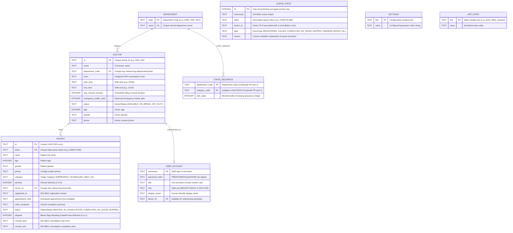

# SmartOPD – Entity-Relationship (ER) Diagram & Schema Specification

This document defines the relational database architecture of SmartOPD, generated directly from the canonical SQLite DDL in `backend/src/main/resources/schema.sql`.

---

## 1. Mermaid Entity-Relationship Diagram

---

## 2. Table Column Specifications & Constraints

| Table Name | Column Name | Data Type | Constraint Type | Description / Domain |
| :--- | :--- | :--- | :--- | :--- |
| **`department`** | `code` | `TEXT` | `PRIMARY KEY` | 3-4 letter department acronym (e.g., `CARD`, `GEN`). |
| | `name` | `TEXT` | `NOT NULL, UNIQUE` | Clinical department name (e.g., `Cardiology`). |
| **`doctor`** | `id` | `TEXT` | `PRIMARY KEY` | Unique doctor identifier (e.g., `DOC-101`). |
| | `name` | `TEXT` | `NOT NULL` | Full doctor name with professional title. |
| | `department_code` | `TEXT` | `NOT NULL, FOREIGN KEY` | References `department(code) ON DELETE RESTRICT`. |
| | `room` | `TEXT` | `NOT NULL` | Physical OPD consultation room number. |
| | `start_time` | `TEXT` | `NOT NULL` | Daily shift commencement time (`HH:mm`). |
| | `end_time` | `TEXT` | `NOT NULL` | Daily shift conclusion time (`HH:mm`). |
| | `avg_consult_minutes` | `INTEGER` | `NOT NULL` | Running exponentially smoothed consultation duration (3–60m). |
| | `emergency_buffer_slots`| `INTEGER` | `NOT NULL` | Number of queue buffer slots reserved for critical admissions. |
| | `status` | `TEXT` | `NOT NULL` | State: `'AVAILABLE'`, `'ON_BREAK'`, `'OFF_DUTY'`. |
| | `age` | `INTEGER` | `NOT NULL` | Doctor age in years. |
| | `gender` | `TEXT` | `NOT NULL` | Doctor gender. |
| | `phone` | `TEXT` | `NOT NULL` | Doctor 10-digit contact mobile number. |
| **`patient`** | `id` | `TEXT` | `PRIMARY KEY` | Unique synthetic identifier (`PAT-` prefix). |
| | `token` | `TEXT` | `NOT NULL, UNIQUE` | Triage ticket token (e.g. `CARD-E-002`, `GEN-W-004`). |
| | `name` | `TEXT` | `NOT NULL` | Patient full legal name. |
| | `age` | `INTEGER` | `NOT NULL` | Patient age in years (1–130). |
| | `gender` | `TEXT` | `NOT NULL` | Patient gender demographic. |
| | `phone` | `TEXT` | `NOT NULL` | Exactly 10 numeric digits. |
| | `category` | `TEXT` | `NOT NULL` | Category: `'EMERGENCY'`, `'SCHEDULED'`, `'WALK_IN'`. |
| | `severity` | `INTEGER` | `NOT NULL, CHECK` | Clinical urgency check: `(severity >= 1 AND severity <= 5)`. |
| | `doctor_id` | `TEXT` | `NOT NULL, FOREIGN KEY` | References `doctor(id) ON DELETE RESTRICT`. |
| | `registered_at` | `TEXT` | `NOT NULL` | ISO-8601 registration timestamp. |
| | `appointment_time` | `TEXT` | `NULLABLE` | Scheduled slot time (`HH:mm`) for scheduled patients. |
| | `chief_complaint` | `TEXT` | `NULLABLE` | Patient clinical symptoms summary. |
| | `status` | `TEXT` | `NOT NULL` | State: `'WAITING'`, `'IN_CONSULTATION'`, `'COMPLETED'`, `'NO_SHOW'`, `'SKIPPED'`. |
| | `skipped` | `INTEGER` | `NOT NULL, DEFAULT 0, CHECK` | Binary indicator: `CHECK (skipped IN (0, 1))`. |
| | `consult_start` | `TEXT` | `NULLABLE` | ISO-8601 timestamp when doctor invoked `callNext()`. |
| | `consult_end` | `TEXT` | `NULLABLE` | ISO-8601 timestamp when doctor invoked `completeConsultation()`. |
| **`token_sequence`** | `department_code`| `TEXT` | `PRIMARY KEY (Part 1)`| Clinical department code. |
| | `category_code` | `TEXT` | `PRIMARY KEY (Part 2)`| Single character ticket code (`E`, `S`, `W`). |
| | `last_value` | `INTEGER` | `NOT NULL` | Atomic sequence counter for collision-free tickets. |
| **`queue_event`** | `id` | `INTEGER` | `PRIMARY KEY AUTOINCREMENT`| Surrogate auto-incrementing event ID. |
| | `timestamp` | `TEXT` | `NOT NULL` | ISO-8601 audit timestamp. |
| | `token` | `TEXT` | `NOT NULL` | Ticket token involved in the queue state change. |
| | `doctor_id` | `TEXT` | `NULLABLE` | Associated doctor room ID. |
| | `type` | `TEXT` | `NOT NULL` | Enum: `REGISTERED`, `CALLED`, `COMPLETED`, `NO_SHOW`, `SKIPPED`, `FAIRNESS_BOOST`, `EMERGENCY_OVERRIDE`, `MOVED_UP`, `MOVED_DOWN`, `CONFIG_CHANGE`. |
| | `reason` | `TEXT` | `NULLABLE` | Plain-English explainability narrative. |
| **`settings`** | `key` | `TEXT` | `PRIMARY KEY` | Algorithmic parameter key (e.g., `severityWeight`). |
| | `value` | `TEXT` | `NOT NULL` | Stringified numerical or boolean value. |
| **`app_state`** | `key` | `TEXT` | `PRIMARY KEY` | Runtime simulation variable (e.g., `clock_offset_minutes`). |
| | `value` | `TEXT` | `NOT NULL` | Serialized system state. |
| **`user_account`** | `username` | `TEXT` | `PRIMARY KEY` | Staff login username (`reception`, `doctor`). |
| | `password_hash` | `TEXT` | `NOT NULL` | PBKDF2WithHmacSHA256 hash. |
| | `salt` | `TEXT` | `NOT NULL` | Hex-encoded random salt string. |
| | `role` | `TEXT` | `NOT NULL, CHECK` | Enforced: `CHECK (role IN ('RECEPTIONIST', 'DOCTOR'))`. |
| | `display_name` | `TEXT` | `NOT NULL` | Staff member title / full name. |
| | `doctor_id` | `TEXT` | `NULLABLE, FOREIGN KEY` | References `doctor(id) ON DELETE SET NULL`. |

---

## 3. Database Indexes

To maintain sub-millisecond query performance during high concurrency, three targeted B-Tree indexes are configured in `schema.sql`:

1. **`idx_patient_doc_status` ON `patient(doctor_id, status)`**:
   - Accelerates `patientDao.findWaitingByDoctor(conn, doctorId)` and `QueueManager.loadDoctorQueueState()`, preventing full-table table scans during queue ordering and call-next operations.
2. **`idx_event_token` ON `queue_event(token)`**:
   - Optimizes timeline generation for the mobile patient tracker (`eventDao.findByToken(conn, token)`), ensuring instant lookups as the audit trail grows.
3. **`idx_event_doc` ON `queue_event(doctor_id)`**:
   - Accelerates doctor console room audit queries (`eventDao.findByDoctor(conn, doctorId, limit)`).

---

## 4. Normalization & Denormalization Analysis

### Normal Form Compliance
- **First Normal Form (1NF):** Satisfied by all 8 tables. All attributes contain strictly atomic, scalar values (strings, integers, timestamps); there are no repeating groups or multivalued arrays.
- **Second Normal Form (2NF):** Satisfied by all tables. In `token_sequence` (the only table with a composite primary key `(department_code, category_code)`), the non-key attribute `last_value` depends functionally on the entire composite key, with zero partial functional dependencies.
- **Third Normal Form (3NF):** Satisfied across primary entities (`department`, `doctor`, `token_sequence`, `settings`, `app_state`, `user_account`). Every non-prime attribute depends solely on the candidate key with no transitive functional dependencies.

### Intentional Denormalization Notes
1. **In-Memory Snapshotting in Java Entities:** While the relational database maintains strict 3NF relationships (e.g. `patient.doctor_id` links to `doctor.id`), the in-memory domain object `Patient.java` retains cached copies of `doctorName`, `room`, and `department` at registration time. This deliberate denormalization guarantees that a patient's printed ticket slip and historical wait estimates remain immutable and permanently explainable, even if a clinic doctor is later reassigned to an alternate OPD consultation room.
2. **Audit Independence in `queue_event`:** The `queue_event` table deliberately omits hard foreign key constraints to `patient(token)` or `doctor(id)`. This architectural decision preserves immutable, tamper-evident audit history even if test fixtures reset patient records or if staff members reconfigure doctor rosters.
