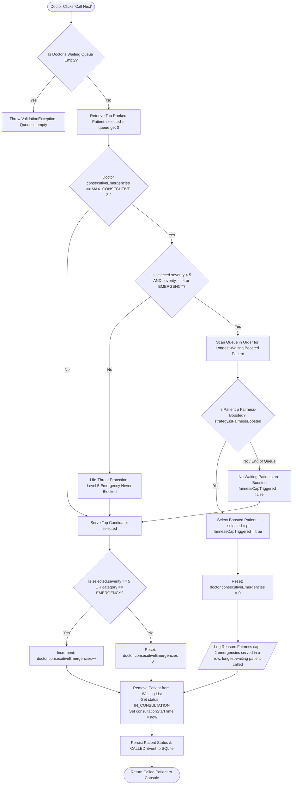
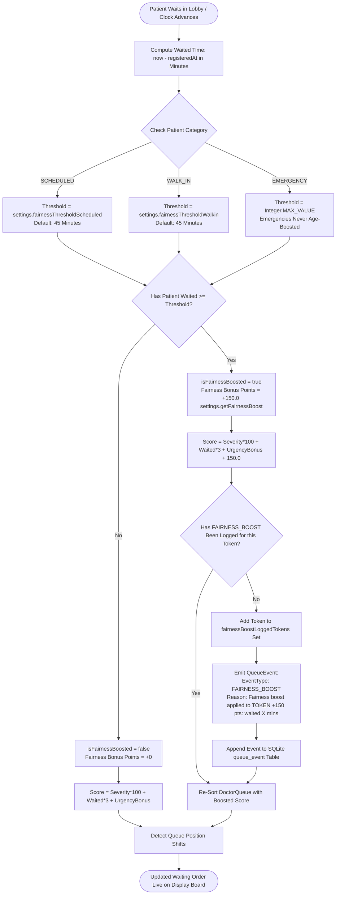

# SmartOPD – Algorithmic Flowcharts

This document specifies the core decision workflows and algorithmic rules of the SmartOPD system using Mermaid flowcharts. Every threshold, condition, and state transition matches the Java source code in `backend/src/main/java/com/smartopd/`.

---

## 1. End-to-End Patient Journey Flowchart

Traces the complete patient lifecycle from front-desk triage and score-ranked queuing through consultation completion and rolling duration recalculation.

```mermaid
flowchart TD
    Start([Patient Enters OPD Clinic]) --> Reception[Front Desk Triage Registration]
    Reception --> FormInput[/Input: Name, Age, Phone, Doctor, Category, Severity 1-5, Slot/]
    
    FormInput --> PreviewCheck{Live Preview 300ms Debounce?}
    PreviewCheck -- Yes --> RunPreview[QueueService.previewPatient: Read-Only Simulation]
    RunPreview --> DisplayPreview[/Show Predicted Queue Slot & Estimated Wait/]
    DisplayPreview --> SubmitBtn[Receptionist Clicks 'Register Patient']
    PreviewCheck -- No --> SubmitBtn

    SubmitBtn --> AcquireLock[Acquire ReentrantLock & Begin SQLite Transaction]
    AcquireLock --> NextToken[TokenSequenceDao: Atomic Department Token Increment]
    NextToken --> CreateSubclass[PatientFactory: Create Emergency / Scheduled / WalkIn]
    CreateSubclass --> PersistPatient[Insert Patient Record into SQLite]

    PersistPatient --> Sev5Check{Is Clinical Severity == Level 5?}
    Sev5Check -- Yes --> EmergencyScore[Assign Score = 10,000.0 Override]
    EmergencyScore --> EnqueueTop[Place at Position #1 in DoctorQueue]
    EnqueueTop --> LogOverride[Log EMERGENCY_OVERRIDE Audit Event]

    Sev5Check -- No --> CalcScore[SmartOpdStrategy: Calculate Dynamic Priority Score]
    CalcScore --> ScoreFormula[Score = Severity*100 + Waited*3 + UrgencyBonus]
    ScoreFormula --> SortedEnqueue[Insert into DoctorQueue by Score Descending]
    SortedEnqueue --> DetectShift[Detect Position Shifts for Existing Patients]
    DetectShift --> LogShifts[Log MOVED_DOWN Events for Displaced Patients]
    LogOverride --> CalcEstimate
    LogShifts --> CalcEstimate

    CalcEstimate[WaitTimeEstimator: Compute Estimated Start Time]
    CalcEstimate --> CommitTx[Commit SQLite Transaction & Release Lock]
    CommitTx --> PrintSlip[/Print Thermal Ticket Slip with QR Code/]
    PrintSlip --> PatientWaits[Patient Waits in Lobby / Monitors Phone Tracker]

    PatientWaits --> DoctorReady[Doctor OPD Room Available]
    DoctorReady --> CallNextAction[Doctor Clicks 'Call Next Patient']
    CallNextAction --> CapRule{Emergency Cap Triggered?}
    CapRule -- Yes --> YieldStarving[Call Longest-Waiting Fairness-Boosted Patient]
    CapRule -- No --> CallTop[Call Highest Priority Waiting Patient]
    
    YieldStarving --> InConsult[Set Patient Status = IN_CONSULTATION]
    CallTop --> InConsult
    InConsult --> WebChime[Public Display Board Updates & Rings WebAudio Chime]
    WebChime --> ConsultationRunning[Clinical Consultation In Progress]

    ConsultationRunning --> CompleteAction[Doctor Clicks 'Complete Consultation']
    CompleteAction --> CalcActualTime[Compute Actual Consultation Duration Mins]
    CalcActualTime --> SmoothAvg[Update Doctor Avg Duration: 70% Old Avg + 30% Actual]
    SmoothAvg --> MarkDone[Set Patient Status = COMPLETED]
    MarkDone --> RecalcEstimates[Recalculate Remaining Queue Wait Times]
    RecalcEstimates --> EndNode([Patient Discharged])
```

---

## 2. `callNext` Decision Logic & Emergency Cap Rule

Implements the anti-starvation triage rule specified in `EmergencyCapSelector.java` (`selectNextPatient`) and enforced in `DoctorQueue.java` (`callNext`).

---

## 3. Anti-Starvation Fairness Boost Decision Flowchart

Implements the dynamic waiting-time aging threshold logic evaluated by `SmartOpdStrategy.java` and audited in `QueueManager.java`.

