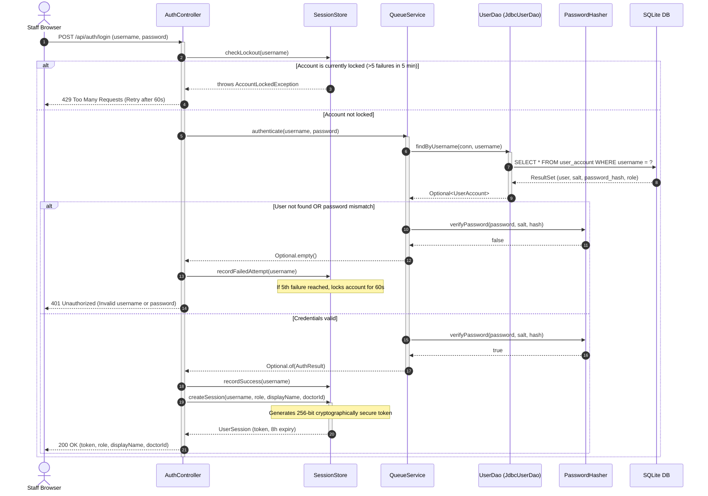
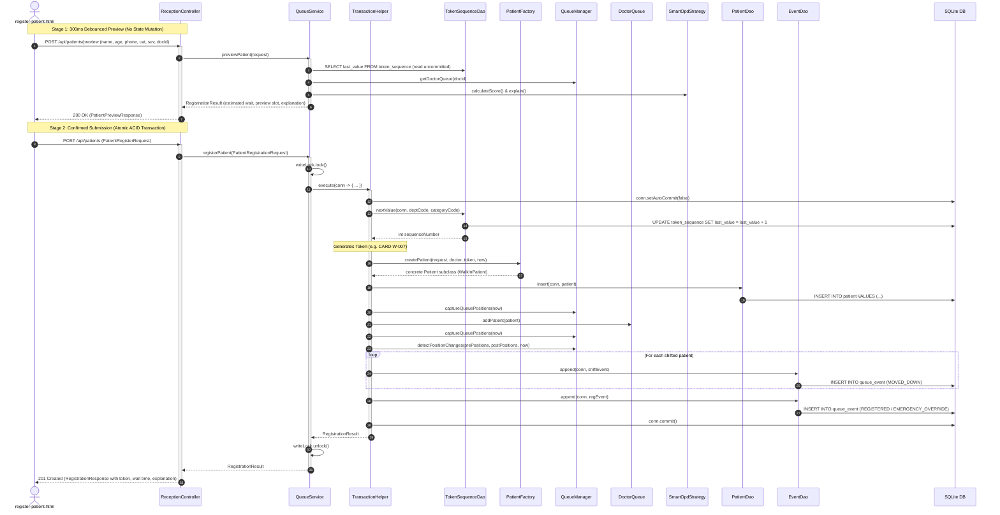
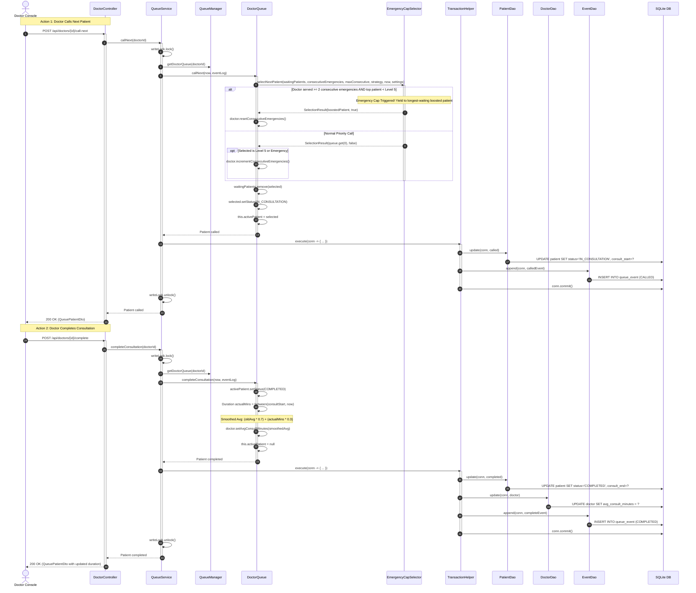
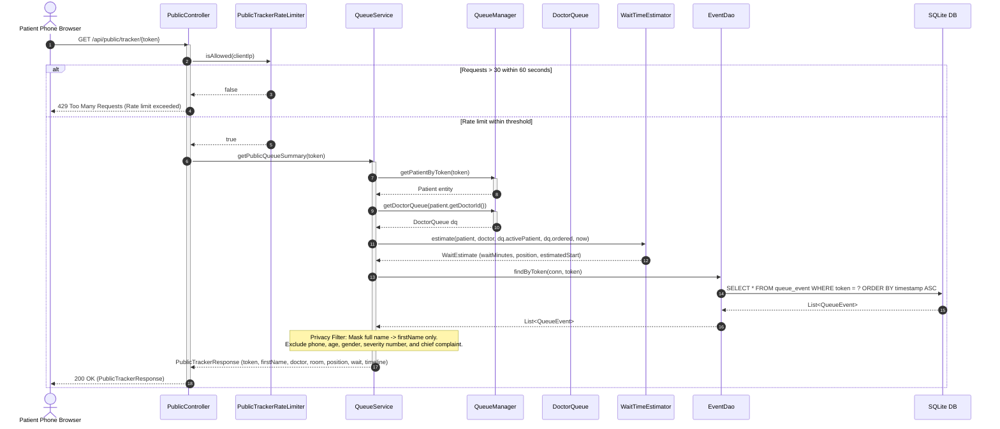
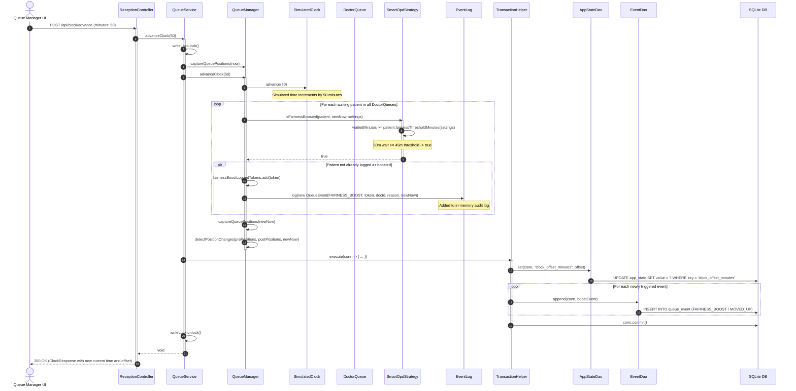
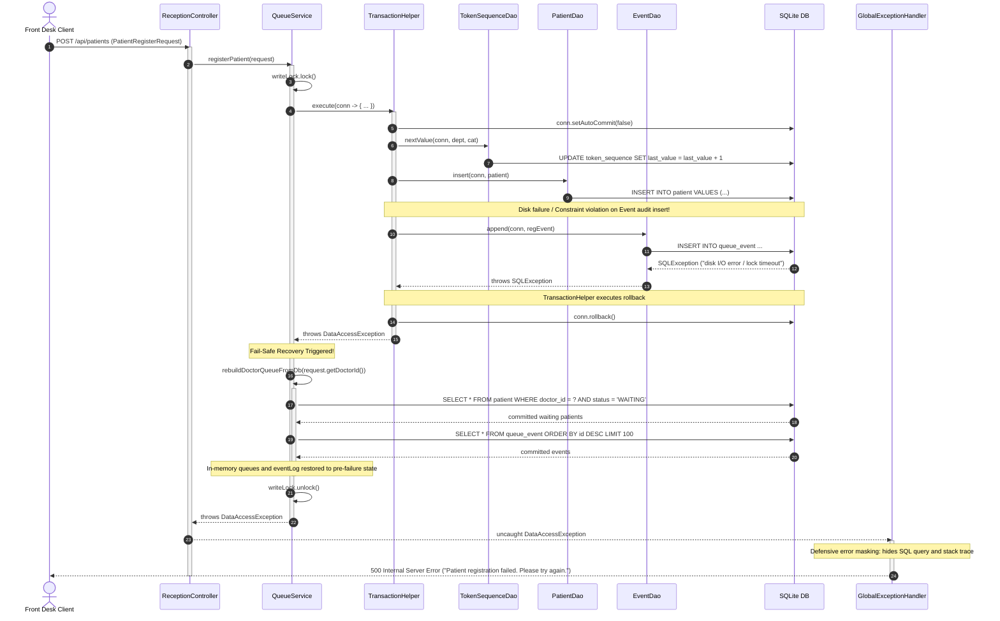

# SmartOPD – UML Sequence Diagrams

This document contains Mermaid sequence diagrams tracing the exact runtime execution paths through the SmartOPD system. Every actor, controller, service, domain entity, and DAO method matches the Java source code in `backend/src/main/java/com/smartopd/`.

---

## 1. User Authentication & Brute-Force Lockout Sequence

This diagram details user sign-in via `AuthController.login()`, demonstrating PBKDF2 cryptographic hash verification, token generation, and the brute-force defense lockout flow.

---

## 2. Patient Registration with Live Preview Sequence

This diagram illustrates the dual-stage registration flow: a debounced read-only preview call (`previewPatient`) that leaves persistent storage unchanged, followed by the atomic transactional registration (`registerPatient`).

---

## 3. Doctor Call-Next & Consultation Completion Sequence

This diagram shows how a doctor calls the next patient (incorporating the emergency cap anti-starvation intervention) and completes the consultation, triggering running average consultation duration smoothing.

---

## 4. Public Patient Mobile Tracker Sequence (Privacy-by-Design)

This diagram details the unauthenticated public tracker query, demonstrating the sliding-window IP rate limiter and the explicit masking of patient Personally Identifiable Information (PII).

---

## 5. Demo Clock Advance & Fairness Boost Detection Sequence

This diagram shows how advancing the simulated clock causes waiting patients who cross their fairness aging threshold (45 minutes) to be boosted (+150 bonus points) and persist audit events.

---

## 6. Transactional Failure & In-Memory Recovery Sequence

This diagram details the fail-safe consistency model: when an unexpected database error occurs mid-transaction, SQLite automatically rolls back and `QueueService` rebuilds in-memory queues directly from committed database state.

