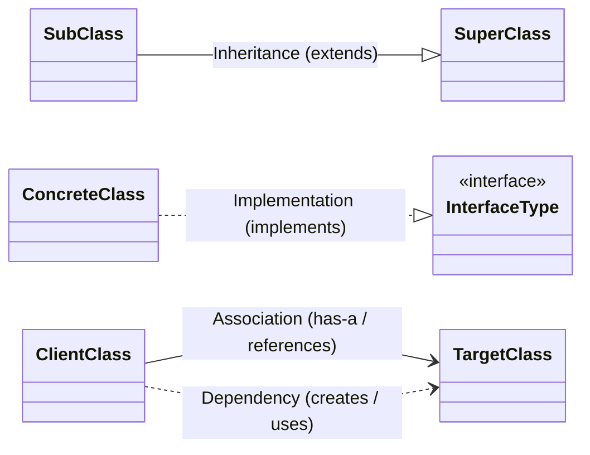
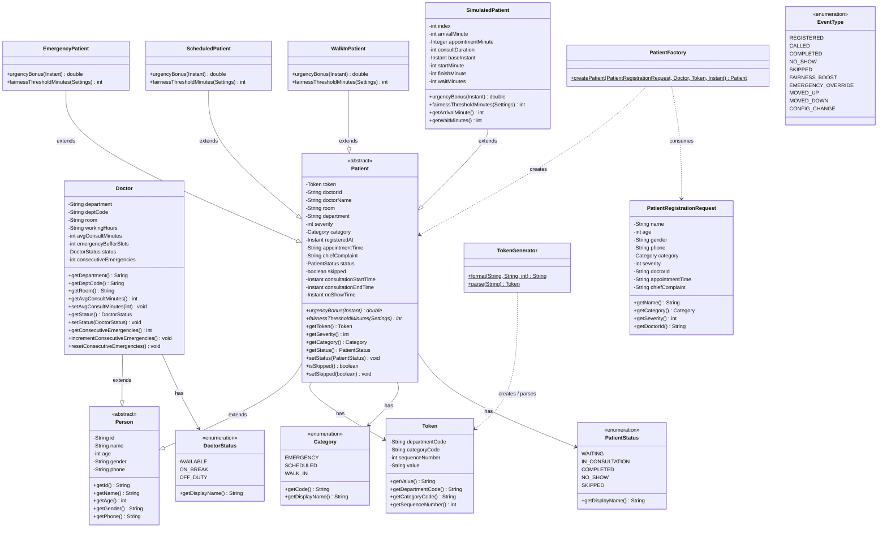
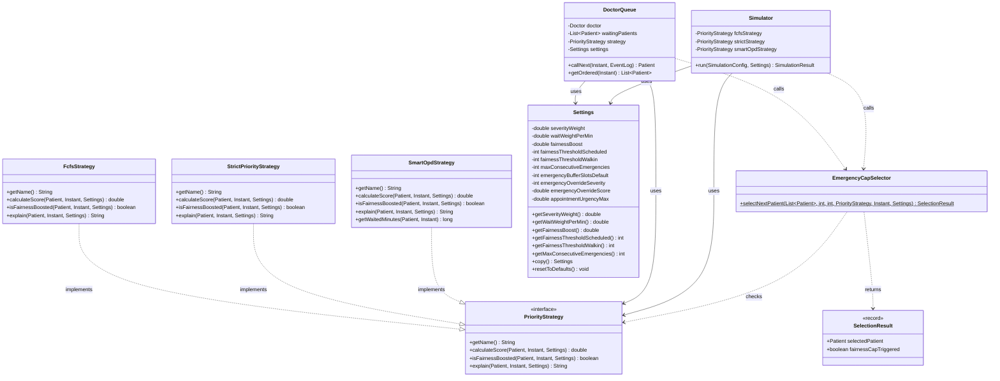
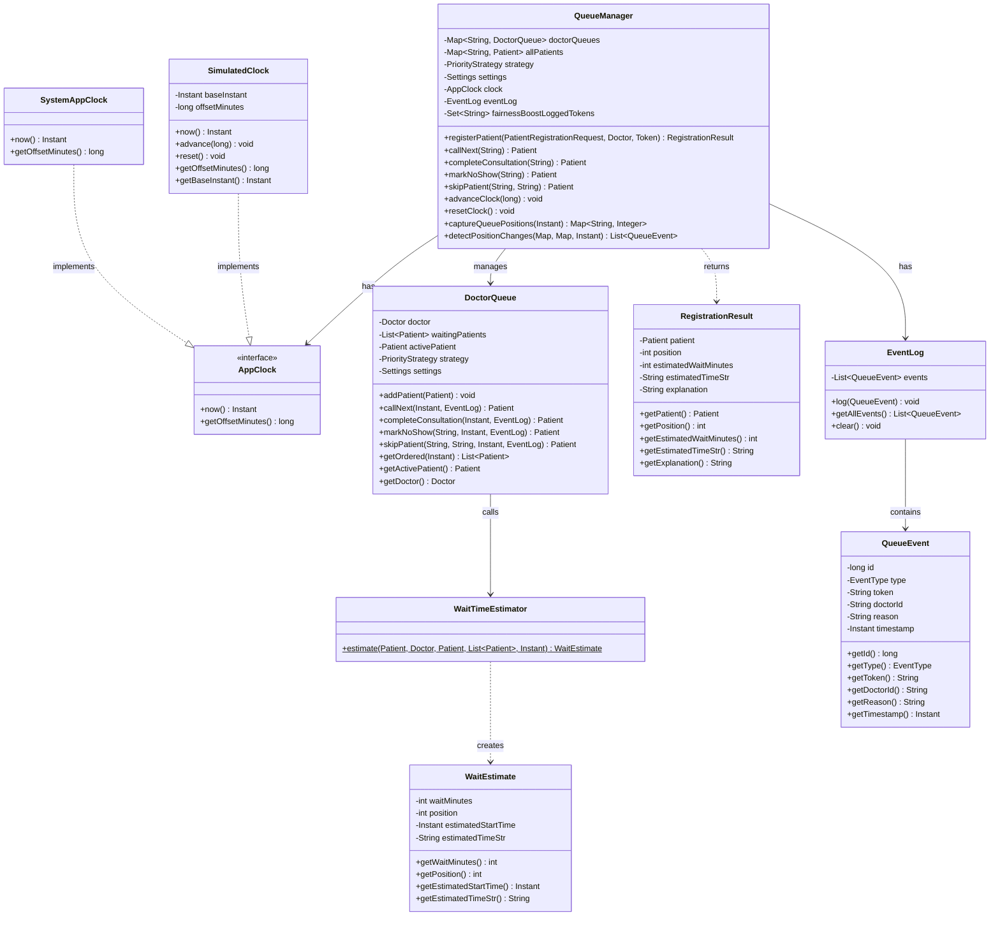
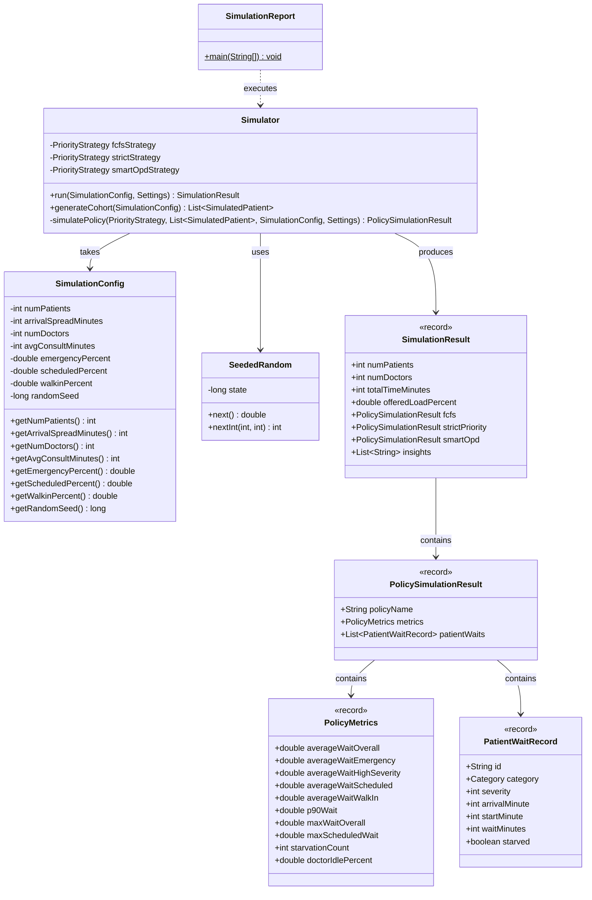

# SmartOPD – UML Class Diagrams

This document contains comprehensive UML class diagrams for the SmartOPD system, reverse-engineered directly from the production Java 17 source code under `backend/src/main/java/com/smartopd/`.

---

## 🧭 Diagram Legend

- **Inheritance (`--|>`)**: A subclass inherits state and behavior from an abstract or concrete superclass (e.g., `Patient --|> Person`).
- **Implementation (`..|>`)**: A concrete class satisfies a formal interface contract (e.g., `SmartOpdStrategy ..|> PriorityStrategy`).
- **Association (`-->`)**: A class maintains a reference or field to another class (e.g., `QueueManager --> DoctorQueue`).
- **Dependency (`..>`)**: A class creates, instantiates, or receives an instance as a method parameter (e.g., `PatientFactory ..> Patient`).

---

## 1. Domain Model Class Diagram

### Explanation
The domain model establishes a clean object hierarchy rooted in the abstract `Person` class, which encapsulates fundamental demographic attributes and validation rules across all hospital actors. `Doctor` extends `Person` with clinical parameters such as consultation duration smoothing and consecutive emergency counters, while `Patient` declares abstract polymorphic hooks (`urgencyBonus` and `fairnessThresholdMinutes`) implemented uniquely by `EmergencyPatient`, `ScheduledPatient`, `WalkInPatient`, and `SimulatedPatient`. Instantiation is strictly decoupled through `PatientFactory` and `TokenGenerator`, ensuring robust triage validation and immutable token formatting before objects enter queues.

---

## 2. Scoring & Strategy Pattern Class Diagram

### Explanation
The scoring engine implements the **Strategy Design Pattern** via `PriorityStrategy`, enabling runtime interchangeability between baseline First-Come-First-Served (`FcfsStrategy`), unconstrained clinical triage (`StrictPriorityStrategy`), and the explainable, aging-aware `SmartOpdStrategy`. Algorithmic configuration is encapsulated within the defensive `Settings` entity, which governs weightings, anti-starvation thresholds, and emergency caps. Crucially, the static `EmergencyCapSelector` is shared identically by both the live clinical `DoctorQueue` and the discrete-event `Simulator`, ensuring 100% mathematical consistency across live hospital operations and offline capacity benchmarks.

---

## 3. Queue Engine Class Diagram

### Explanation
The queue coordination engine is orchestrated by `QueueManager`, which manages individual `DoctorQueue` instances for each clinical provider and coordinates temporal evaluations through the `AppClock` abstraction (`SimulatedClock` enables interactive time travel during demonstrations). `DoctorQueue` coordinates waiting patient collections, consultation lifecycle states, and position-shift auditing. When patients register or advance in the queue, `WaitTimeEstimator` calculates deterministic consultation start times based on doctor-specific smoothed durations and preceding emergency buffers, capturing the outcome in an immutable `WaitEstimate` and broadcasting changes into `EventLog`.

---

## 4. Persistence Architecture Class Diagram

```mermaid
classDiagram
    direction TB

    class ConnectionProvider {
        +DB_PATH_PROPERTY String
        +DB_PATH_ENV String
        +DEFAULT_DB_PATH String
        -String dbPath
        +resolveDbPath()$ String
        +getConnection() Connection
        +getDbPath() String
    }

    class TransactionHelper {
        -ConnectionProvider connectionProvider
        +execute(TransactionCallback~T~) T
        +executeVoid(VoidTransactionCallback) void
    }

    class SchemaInitializer {
        -ConnectionProvider connectionProvider
        +initialize() void
    }

    class DefaultsInitializer {
        -ConnectionProvider connectionProvider
        +initializeIfEmpty(Connection)$ void
        +initialize(Connection) void
    }

    class PasswordHasher {
        -PBKDF2_ALGO String
        -ITERATIONS int
        -KEY_LENGTH int
        +hashPassword(String, byte[])$ String
        +generateSalt()$ byte[]
        +verifyPassword(String, String, String)$ boolean
    }

    class DepartmentDao {
        <<interface>>
        +findAll(Connection) List~Department~
        +findByCode(Connection, String) Optional~Department~
        +insert(Connection, Department) void
    }
    class JdbcDepartmentDao {
        +findAll(Connection) List~Department~
        +findByCode(Connection, String) Optional~Department~
        +insert(Connection, Department) void
    }

    class DoctorDao {
        <<interface>>
        +findAll(Connection) List~Doctor~
        +findById(Connection, String) Optional~Doctor~
        +insert(Connection, Doctor) void
        +update(Connection, Doctor) void
        +delete(Connection, String) void
    }
    class JdbcDoctorDao {
        +findAll(Connection) List~Doctor~
        +findById(Connection, String) Optional~Doctor~
        +insert(Connection, Doctor) void
        +update(Connection, Doctor) void
        +delete(Connection, String) void
    }

    class PatientDao {
        <<interface>>
        +findAll(Connection) List~Patient~
        +findByToken(Connection, String) Optional~Patient~
        +findWaitingByDoctor(Connection, String) List~Patient~
        +findByStatus(Connection, PatientStatus) List~Patient~
        +insert(Connection, Patient) void
        +update(Connection, Patient) void
    }
    class JdbcPatientDao {
        +findAll(Connection) List~Patient~
        +findByToken(Connection, String) Optional~Patient~
        +findWaitingByDoctor(Connection, String) List~Patient~
        +findByStatus(Connection, PatientStatus) List~Patient~
        +insert(Connection, Patient) void
        +update(Connection, Patient) void
    }

    class TokenSequenceDao {
        <<interface>>
        +nextValue(Connection, String, String) int
        +resetAll(Connection) void
    }
    class JdbcTokenSequenceDao {
        +nextValue(Connection, String, String) int
        +resetAll(Connection) void
    }

    class EventDao {
        <<interface>>
        +append(Connection, QueueEvent) void
        +findAll(Connection, int) List~QueueEvent~
        +findByToken(Connection, String) List~QueueEvent~
    }
    class JdbcEventDao {
        +append(Connection, QueueEvent) void
        +findAll(Connection, int) List~QueueEvent~
        +findByToken(Connection, String) List~QueueEvent~
    }

    class SettingsDao {
        <<interface>>
        +load(Connection) Settings
        +save(Connection, Settings) void
    }
    class JdbcSettingsDao {
        +load(Connection) Settings
        +save(Connection, Settings) void
    }

    class AppStateDao {
        <<interface>>
        +get(Connection, String) Optional~String~
        +set(Connection, String, String) void
    }
    class JdbcAppStateDao {
        +get(Connection, String) Optional~String~
        +set(Connection, String, String) void
    }

    class UserDao {
        <<interface>>
        +findByUsername(Connection, String) Optional~UserAccount~
        +insert(Connection, UserAccount) void
    }
    class JdbcUserDao {
        +findByUsername(Connection, String) Optional~UserAccount~
        +insert(Connection, UserAccount) void
    }

    JdbcDepartmentDao ..|> DepartmentDao : implements
    JdbcDoctorDao ..|> DoctorDao : implements
    JdbcPatientDao ..|> PatientDao : implements
    JdbcTokenSequenceDao ..|> TokenSequenceDao : implements
    JdbcEventDao ..|> EventDao : implements
    JdbcSettingsDao ..|> SettingsDao : implements
    JdbcAppStateDao ..|> AppStateDao : implements
    JdbcUserDao ..|> UserDao : implements

    TransactionHelper --> ConnectionProvider : uses
    SchemaInitializer --> ConnectionProvider : uses
    DefaultsInitializer --> ConnectionProvider : uses
```

### Explanation
Persistence follows the **DAO (Data Access Object) Pattern**, establishing strict separation between business entities and raw JDBC SQL statements executed against SQLite 3.4x. `ConnectionProvider` configures relational foreign keys, Write-Ahead Logging (`PRAGMA journal_mode = WAL`), and busy timeouts, while `TransactionHelper` coordinates atomic commit and automatic rollback blocks. System security is guaranteed via `PasswordHasher` using PBKDF2WithHmacSHA256 with 120,000 rounds and random 16-byte salts, while `SchemaInitializer` and `DefaultsInitializer` ensure database creation and default settings initialization remain 100% idempotent.

---

## 5. Service & API Layer Class Diagram

```mermaid
classDiagram
    direction TB

    class QueueService {
        -ConnectionProvider connectionProvider
        -TransactionHelper transactionHelper
        -QueueManager queueManager
        -SimulatedClock clock
        -Settings settings
        -ReentrantLock writeLock
        +registerPatient(PatientRegistrationRequest) RegistrationResult
        +previewPatient(PatientRegistrationRequest) RegistrationResult
        +callNext(String) Patient
        +completeConsultation(String) Patient
        +markNoShow(String) Patient
        +skipPatient(String, String) Patient
        +setDoctorStatus(String, DoctorStatus) void
        +advanceClock(long) void
        +resetClock() void
        +updateSettings(Settings) void
        +authenticate(String, String) Optional~AuthResult~
        +getPublicBoardData() List~PublicBoardDoctorDto~
        +getPublicQueueSummary(String) PublicTrackerResponse
    }

    class AuthController {
        -QueueService queueService
        -SessionStore sessionStore
        +login(LoginRequest) ResponseEntity
        +logout(HttpServletRequest) ResponseEntity
        +me(HttpServletRequest) ResponseEntity
    }

    class DoctorController {
        -QueueService queueService
        +getDoctorQueue(String) ResponseEntity
        +callNext(String) ResponseEntity
        +completeConsultation(String) ResponseEntity
        +updateDoctorStatus(String, DoctorStatusRequest) ResponseEntity
    }

    class PublicController {
        -QueueService queueService
        -PublicTrackerRateLimiter rateLimiter
        +getPublicBoard() ResponseEntity
        +getPublicTracker(String, HttpServletRequest) ResponseEntity
        +getSampleTokens() ResponseEntity
    }

    class ReceptionController {
        -QueueService queueService
        +registerPatient(PatientRegisterRequest) ResponseEntity
        +previewPatient(PatientRegisterRequest) ResponseEntity
        +getPatient(String) ResponseEntity
        +getQueues() ResponseEntity
        +advanceClock(ClockAdvanceRequest) ResponseEntity
        +resetClock() ResponseEntity
        +updateSettings(SettingsDto) ResponseEntity
        +getAnalytics() ResponseEntity
    }

    class SimulationController {
        -QueueService queueService
        -Simulator simulator
        +getPresets() ResponseEntity
        +runSimulation(SimulationRunRequest) ResponseEntity
    }

    class AuthInterceptor {
        -SessionStore sessionStore
        +preHandle(HttpServletRequest, HttpServletResponse, Object) boolean
    }

    class SessionStore {
        -Map~String, UserSession~ sessions
        -Map~String, FailedLoginRecord~ failedAttempts
        +createSession(String, String, String, String) UserSession
        +getSession(String) Optional~UserSession~
        +invalidateSession(String) void
        +recordFailedAttempt(String) void
        +checkLockout(String) void
    }

    class GlobalExceptionHandler {
        +handleValidation(ValidationException) ResponseEntity
        +handleDoctorUnavailable(DoctorUnavailableException) ResponseEntity
        +handleResourceNotFound(ResourceNotFoundException) ResponseEntity
        +handleLockout(AccountLockedException) ResponseEntity
        +handleRateLimit(RateLimitExceededException) ResponseEntity
        +handleGeneral(Exception) ResponseEntity
    }

    class SmartOpdException {
        <<exception>>
        +SmartOpdException(String)
        +SmartOpdException(String, Throwable)
    }

    class ValidationException {
        <<exception>>
    }
    class DoctorUnavailableException {
        <<exception>>
    }
    class ResourceNotFoundException {
        <<exception>>
    }
    class SlotFullException {
        <<exception>>
    }
    class DuplicateTokenException {
        <<exception>>
    }
    class InvalidSeverityException {
        <<exception>>
    }

    class LoginRequest {
        <<record>>
        +String username
        +String password
    }
    class LoginResponse {
        <<record>>
        +String token
        +String role
        +String displayName
        +String doctorId
    }
    class PatientRegisterRequest {
        <<record>>
        +String name
        +int age
        +String gender
        +String phone
        +String category
        +int severity
        +String doctorId
        +String appointmentTime
        +String chiefComplaint
    }
    class RegistrationResponse {
        <<record>>
        +String token
        +int position
        +int estimatedWaitMinutes
        +String estimatedTimeStr
        +String explanation
    }

    ValidationException --|> SmartOpdException : extends
    DoctorUnavailableException --|> SmartOpdException : extends
    ResourceNotFoundException --|> SmartOpdException : extends
    SlotFullException --|> SmartOpdException : extends
    DuplicateTokenException --|> SmartOpdException : extends
    InvalidSeverityException --|> SmartOpdException : extends

    AuthController --> QueueService : uses
    AuthController --> SessionStore : uses
    DoctorController --> QueueService : uses
    PublicController --> QueueService : uses
    ReceptionController --> QueueService : uses
    SimulationController --> QueueService : uses
    AuthInterceptor --> SessionStore : uses

    AuthController ..> LoginRequest : consumes
    AuthController ..> LoginResponse : returns
    ReceptionController ..> PatientRegisterRequest : consumes
    ReceptionController ..> RegistrationResponse : returns
```

### Explanation
The application service layer is unified behind `QueueService` as a centralized **Facade Pattern**, coordinating write-through SQLite updates serialized with a fair `ReentrantLock` alongside fast in-memory queue lookups. The REST controllers (`AuthController`, `DoctorController`, `PublicController`, `ReceptionController`, `SimulationController`) expose clean HTTP endpoints with strongly-typed Java records as Data Transfer Objects (DTOs). Cross-cutting security is handled declaratively by `AuthInterceptor` (enforcing token validity and `@RequiresRole` checks) and `SessionStore` (managing 256-bit bearer tokens and sliding-window lockout), while `GlobalExceptionHandler` masks database internals and formats standardized RFC 7807 problem responses.

---

## 6. Discrete-Event Simulation Engine Class Diagram

### Explanation
The simulation engine models outpatient clinic capacity using a pure Java **Discrete-Event Simulation (DES)** architecture capable of processing 500 patient encounters in under 50 milliseconds. `SeededRandom` implements the 32-bit Mulberry32 algorithm to guarantee identical pseudo-random number sequences between Java and JavaScript golden tests. When `Simulator.run` executes, it synthesizes patient arrival queues across configured clinical triage mixes and benchmarks FCFS, Strict Priority, and SmartOPD in parallel, capturing per-patient wait statistics in immutable `PolicySimulationResult` records for comparative telemetry and CSV export.
